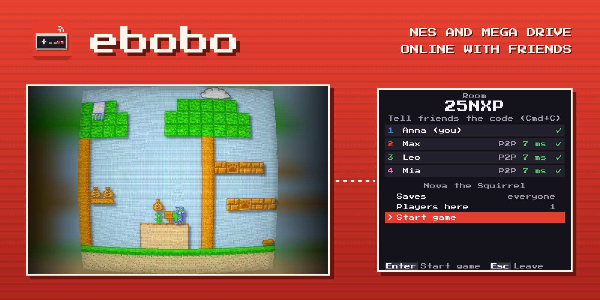

# ebobo



A NES and Sega Mega Drive / Genesis emulator for playing with friends over the internet. It runs on a Mac, a Windows PC and a Steam Deck, with up to four players in a game.

The host creates a room and gets a code of five characters. Everyone else joins by the code, and the ROM travels from the host. Rollback netcode keeps the game at full speed on a bad connection. A player who dropped out joins again with the same code.

No games included. Bring your own ROMs.

## Install

**Mac** (macOS 11+): unzip [ebobo-mac.zip](https://github.com/idoo/ebobo/releases/latest/download/ebobo-mac.zip) and drag ebobo.app to Applications.

**Windows** (10 or later, 64-bit): unzip [ebobo-windows.zip](https://github.com/idoo/ebobo/releases/latest/download/ebobo-windows.zip) and run ebobo.exe. Windows may warn about an unknown publisher: More info, then Run anyway.

**Steam Deck**: in Desktop Mode open Konsole and run

```sh
curl -sL https://github.com/idoo/ebobo/releases/latest/download/install-steamdeck.sh | bash
```

ebobo then shows up in Steam under Non-Steam. The same line works on other x86_64 Linux.

Every install updates itself on launch.

ROMs (`.nes`, `.md`, `.gen`, `.smd`, `.bin`, or a `.zip` of one) are found in the `ROMs` and `Downloads` folders of your home folder and in EmuDeck's folders. You can also drop one on the window.

## Keys

Arrows move, X is A, Z is B, Enter is Start, right Shift is Select, Esc opens the menu. Mega Drive games take Z X C as A B C and A S D as X Y Z. Tab fast-forwards, Backspace rewinds, F5 and F7 save and load.

PlayStation, Xbox and Switch gamepads work over USB or Bluetooth. Settings has an HD filter and three picture effects: an old CRT TV, a studio monitor and a handheld LCD.

## Building

```sh
cargo run --release -p ebobo
scripts/fetch-test-roms.sh && scripts/fetch-md-test-roms.sh && cargo test
```

Both cores are written from scratch. The Mega Drive one is new and has been checked on free homebrew and demos only, so open an issue if a game misbehaves.

Rooms go through a small Cloudflare Worker in `worker/`. ebobo uses mine by default. To run your own on the free Cloudflare plan, install Node.js and run `scripts/deploy-server.sh`, then enter the URL it prints in Settings > Advanced > Server.

## License

MIT. The HD filter is a port of [MMPX](https://casual-effects.com/research/McGuire2021PixelArt/) by Morgan McGuire and Mara Gagiu (MIT). Rollback is [GGRS](https://github.com/gschup/ggrs) (MIT or Apache-2.0), patched in `vendor/ggrs`. The game in the picture is [Nova the Squirrel](https://github.com/NovaSquirrel/NovaTheSquirrel), free homebrew for the NES.
